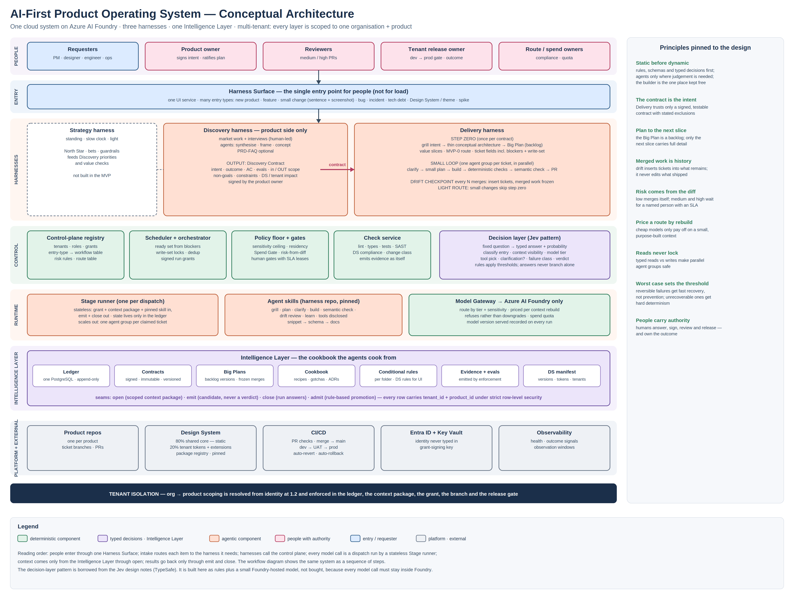
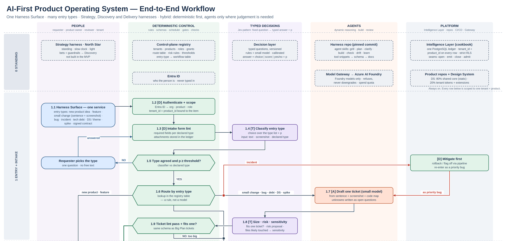
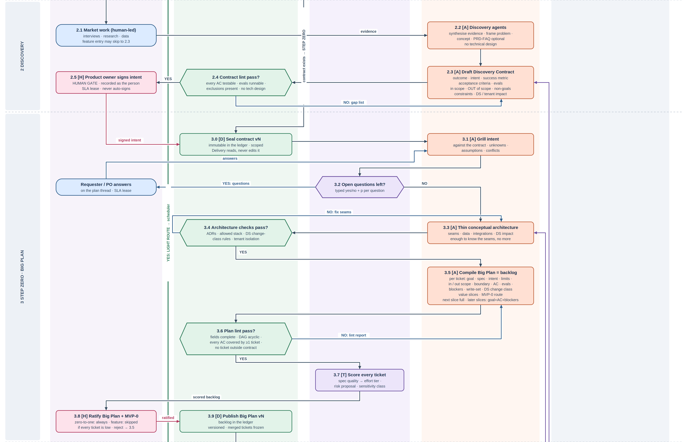
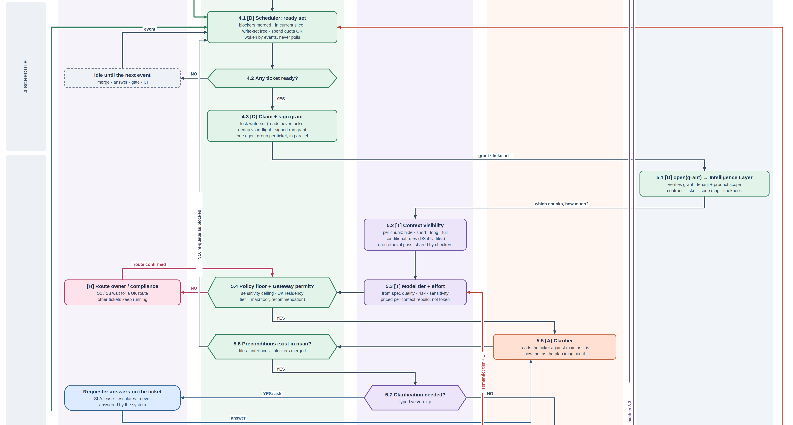
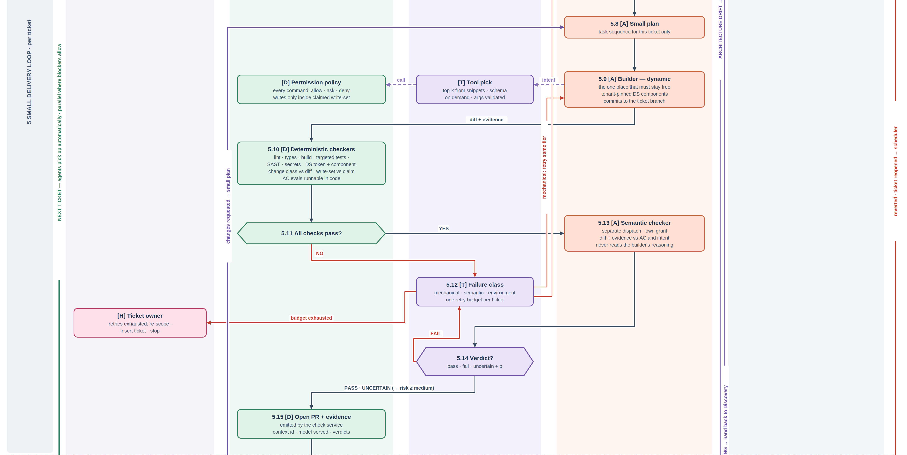
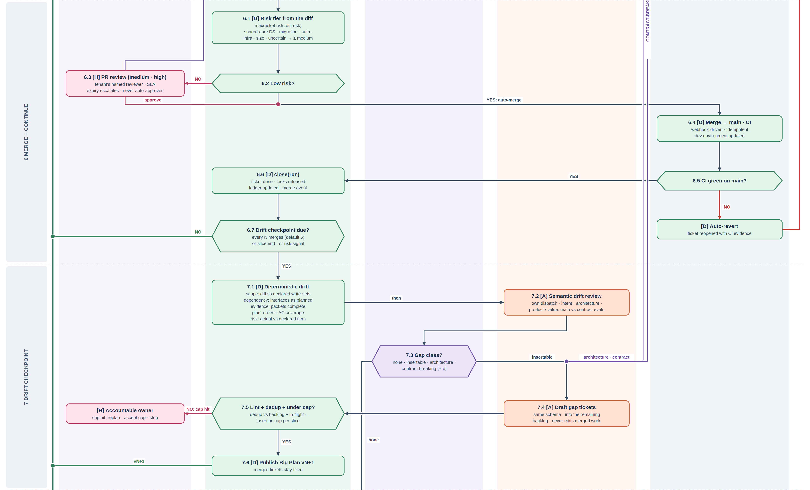
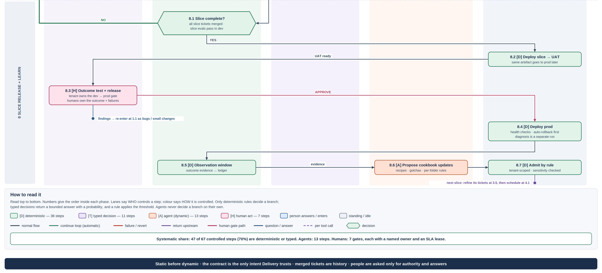

# AI-First Product Operating System

*Architecture and end-to-end workflow · v0.8*

A greenfield, cloud-hosted system that works like Claude Code running in the cloud, on Azure AI Foundry models only. People enter through one Harness Surface. Strategy, Discovery and Delivery run inside the system as harnesses. The system serves many organisations and many products, and each product sees only its own information.

| Field | Value |
| --- | --- |
| Version | 0.8 |
| Date | 27 September 2026 |
| Owner | Sam |
| Status | Concept for review. It describes the full workflow so the MVP can be sliced from it (section 16). It is not a build specification. |
| Scope | The whole system: entry, intake, Strategy, Discovery and Delivery harnesses, Intelligence Layer, Design System, CI/CD, multi-tenancy. Retrieval internals are out of scope. |
| Figures | Figure 1: conceptual architecture. Figure 2 (six parts): end-to-end workflow. Both ship as 2× PNG plus SVG source. |
| Borrowed pattern | The decision-layer pattern follows the Jev design notes by Diogo Almeida (TypeSafe), as compiled in an independent September 2026 study note. The pattern is borrowed; the product is not adopted (section 3.4). |

## TL;DR

The system turns an idea, a request or a fault into merged, released and observed software, and it asks people only for answers and authority. It is hybrid by design: rules and typed decisions carry most of the control, and agents are used where judgement is genuinely needed.

- One entry service, many entry types. The Harness Surface takes a new product idea, a feature, a small change with a screenshot, a bug, an incident, tech debt, a Design System change, a spike or a signed contract. Intake classifies the item and a registry table routes it. No model decides the route.

- Three harnesses, one direction. Strategy is a light, standing North Star and is not built in the MVP. Discovery is product-side only and ends in a signed Discovery Contract. Delivery turns that contract into merged software.

- The contract is the only intent Delivery trusts. It holds testable acceptance criteria, evals, what is out of scope and the non-goals. A PRD-FAQ is an optional input to it, not the handoff. This is what makes intent drift and value drift detectable later.

- Step zero comes before any build. Delivery grills the intent, draws a thin conceptual architecture, and compiles a Big Plan: a backlog of tickets with value slices and an MVP-0 route. Only the next slice carries full detail.

- A small loop per ticket, in parallel. Each ready ticket gets its own agent group: clarify against main as it is now, plan the tasks, build, run deterministic checks, run a separate semantic check, open a PR. A merge automatically wakes the scheduler for the next ready tickets.

- Risk comes from the diff. The tier is the higher of the ticket's declared risk and the risk read from the actual diff. Low risk merges itself. Medium and high risk wait for a named reviewer with an SLA.

- Drift is checked in chunks. Every N merges (default 5) the eight drift classes compare main with the contract and the plan. Merged tickets are never edited; gaps become new tickets inserted into the rest of the backlog, under a cap.

- 70% of controlled steps are deterministic or typed. Of the 67 controlled steps in Figure 2, 47 are rules or typed decisions, 13 are agent steps and 7 are human gates. The builder is the one place that is left fully dynamic.

- The Jev pattern saves time and money. Context is scored per query, tools are disclosed in tiers, routes are priced per context rebuild, and reads never lock. Checkers share one retrieval pass.

- Thresholds follow the worst case. Reversible failures get fast detection and recovery rather than prevention. Unrecoverable ones (cross-tenant exposure, data leaving the permitted region, an unapproved production release) get hard determinism and a person.

## 1. What the system is

### 1.1 One system, three harnesses

The system is a single cloud runtime: it builds its own runtime, scales its own agents and runs every model call through Azure AI Foundry. A harness is a subsystem of it. "Factory" is not used inside this document.

| Harness | Purpose | Takes in | Hands out | Human authority | MVP |
| --- | --- | --- | --- | --- | --- |
| Strategy | North Star, bets and guardrails for the business | Leadership direction, market signal, outcome evidence | Priorities and value guardrails that Discovery reads | Leadership sets it | Not built. A document the Discovery agents may read |
| Discovery | Decide what to build and why. Product side only; no technical design | Interviews, research, data, an idea | A signed Discovery Contract | Product owner signs the intent | Contract template and lint; agents optional |
| Delivery | Turn the contract into merged, released software | Contract (zero-to-one, large feature) or a single ticket (light route) | Merged code, releases, outcome evidence | Plan ratification, medium/high PR review, release | Built first |

### 1.2 What AI-first means here

AI-first does not mean people are out of the loop. It means people appear only where their answer or their authority is needed, and the system does everything else. People answer clarifying questions, sign intent, ratify the plan, review medium and high risk PRs and approve release to production. People own the outcome and take responsibility for failures; the system makes each of those decisions cheap, well evidenced and recorded under the person's identity.

### 1.3 Multi-tenancy

The system serves many organisations, and each organisation can have many products. Working on product A returns only product A's information and never organisation B's.

- One database, scoped rows. One PostgreSQL ledger holds everything. Every row carries tenant_id and product_id, and strict row-level security enforces them. There is no database per tenant.

- Scope comes from identity. Step 1.2 resolves organisation, product and role from Entra ID. The scope is bound to the item and travels in the signed run grant; no agent can widen it.

- Scope is enforced in five places. The ledger query, the context package returned by open, the run grant, the repository branch, and the release gate.

- The Design System is configurable only where it is configurable. About 80% is shared core and static; about 20% is tenant tokens and declared extensions. Tenants change only the 20%.

## 2. Conceptual architecture

Figure 1 shows the system as layers. People enter at the top through one service. The harnesses call a deterministic control plane. Every model call is a dispatch run by a stateless Stage runner. All context comes from the Intelligence Layer through open, and all results go back through emit and close. The platform row holds the repositories, the Design System, CI/CD and identity.

Figure 1. Conceptual architecture. Colour gives the control type; the principles on the right are the rules the workflow is checked against.

### 2.1 Components by layer

| Layer | Component | Responsibility | Control type |
| --- | --- | --- | --- |
| Entry | Harness Surface | The single UI service for people. Takes every entry type, shows questions and gates, and shows progress. | Deterministic |
| Harnesses | Strategy harness | North Star and guardrails. Standing input, slow clock. Not built in the MVP. | Agentic (later) |
| Harnesses | Discovery harness | Research synthesis, framing, concept and the Discovery Contract. | Agentic + human |
| Harnesses | Delivery harness | Step zero (Big Plan), small loop per ticket, drift checkpoints, slice release. | Hybrid |
| Control | Control-plane registry | Tenants, roles, grants, the entry-type → workflow table, risk rules, route table, thresholds. Versioned in git. | Deterministic |
| Control | Scheduler + orchestrator | Computes the ready set from blockers, locks write-sets, removes duplicates, signs run grants, spawns agent groups. | Deterministic |
| Control | Policy floor + gates | Sensitivity ceiling, UK residency, Spend Gate, risk-from-diff, human gates with SLA leases. | Deterministic |
| Control | Check service | Runs lint, types, build, targeted tests, SAST, secrets, Design System and change-class checks; emits evidence under its own identity. | Deterministic |
| Control | Decision layer | Answers fixed questions with a typed answer and a probability (section 3.4). | Typed |
| Runtime | Stage runner | Runs one dispatch: open → model → emit → close. Holds no state between dispatches, so it scales out. | Deterministic shell |
| Runtime | Agent skills | Grill, plan, clarify, build, semantic check, drift review, learn. Pinned commit in the harness repo. | Agentic |
| Runtime | Model Gateway | Routes to Foundry models by tier and sensitivity; refuses rather than downgrades; records the model served. | Deterministic |
| Intelligence | Ledger | One append-only PostgreSQL store. The only memory the system has. | Deterministic |
| Intelligence | Contracts, Big Plans | Signed contracts (immutable, versioned) and Big Plan versions with frozen merged tickets. | Deterministic |
| Intelligence | Cookbook | Recipes, gotchas, ADRs, per-folder rules and Design System manifest for each tenant and product. | Curated |
| Platform | Product repos, Design System repo, CI/CD, environments | Branches, PRs, packages, dev → UAT → prod, revert and rollback. | Deterministic |
| Platform | Entra ID, Key Vault, observability | Identity, grant-signing key, health and outcome signals. | Deterministic |

## 3. The hybrid control model

A pure agent workflow is flexible but hard to hold to a standard: every step can come back in a different shape. This system does the opposite. It fixes as much as possible first and lets the work become dynamic only where it must.

### 3.1 Four control types

| Type | What it is | Where it is used | Why |
| --- | --- | --- | --- |
| [D] Deterministic | Code, schemas, rules, tables, tests. Same input gives the same output. | Auth, lint, routing table, scheduler, locks, checks, risk-from-diff, merge, deploy, drift classes that can be computed | Cheap, fast, auditable; failures are explainable |
| [T] Typed decision | A fixed question to the decision layer. Answer is a choice, a score or yes/no, with a probability. A rule applies the threshold. | Entry type, ticket size, context visibility, model tier, tool pick, clarification needed, failure class, verdict, gap class | Judgement is needed but the output shape must be fixed so rules can branch on it |
| [A] Agent | A model dispatch with a skill. Output is free-form and becomes a candidate, never a verdict. | Discovery synthesis, contract draft, grilling, conceptual architecture, Big Plan, clarifier, small plan, builder, semantic checker, drift review | Real reasoning or generation is needed |
| [H] Human | A person acts; the act is recorded under their identity. | Sign intent, ratify plan, route/compliance, PR review (medium/high), ticket owner, cap owner, release | Accountability sits with a person |

### 3.2 Three rules that keep it hybrid

- Only rules branch. An agent never decides where the flow goes. A typed decision returns an answer with a probability, and a rule in the registry applies the threshold. Below the threshold, the rule sends the item to the safer path.

- Static before dynamic. Each phase runs its deterministic steps first. The semantic checker runs only after deterministic checks pass. The semantic drift review runs after the deterministic drift classes.

- The builder stays free. The builder is the one step that must be fully dynamic. It is bounded from outside, not from inside: a claimed write-set, a permission policy on every command, tiered tools, and checks after it.

### 3.3 How systematic it is

Counting the controlled steps in Figure 2 (boxes and decisions, excluding standing components and places where a person only answers a question):

| Phase | Deterministic | Typed | Agent | Human | Systematic share |
| --- | --- | --- | --- | --- | --- |
| 1 Entry + intake | 6 | 2 | 1 | 0 | 89% |
| 2 Discovery | 1 | 0 | 2 | 1 | 25% |
| 3 Step zero · Big Plan | 4 | 2 | 3 | 1 | 60% |
| 4 Schedule | 3 | 0 | 0 | 0 | 100% |
| 5 Small delivery loop (per ticket) | 7 | 6 | 4 | 2 | 68% |
| 6 Merge + continue | 7 | 0 | 0 | 1 | 88% |
| 7 Drift checkpoint | 3 | 1 | 2 | 1 | 57% |
| 8 Slice release + learn | 5 | 0 | 1 | 1 | 71% |
| Total | 36 | 11 | 13 | 7 | 70% |

Read this number carefully. It counts control points, not cost. Agent steps are few but they consume most tokens and most wall-clock time. The target that matters is that no branch, gate or merge depends on free-form model output. Discovery is the least systematic phase by design: it is where product judgement lives.

### 3.4 The decision layer: what is borrowed from Jev

The Jev design notes argue that a coding agent is a simple loop, and that the leverage is in what the harness puts in front of the model on each turn. A decision model answers fixed questions at high-frequency points with typed outputs. This system borrows that pattern because it removes most of the time and token waste in an agent run.

| Jev idea | What it fixes | Where it lands here |
| --- | --- | --- |
| Typed decisions at high-frequency points | Harness cannot branch on prose | All [T] steps: 1.4, 1.8, 3.2, 3.7, 5.2, 5.3, tool pick, 5.7, 5.12, 5.14, 7.3 |
| Context as a decision (visibility ladder: hide / short / long / full) | Blind compaction; transcripts that grow until they are restarted | 5.2 inside open: each chunk is scored for this ticket and this question. Nothing is deleted from the ledger; it is just not shown |
| Route priced per context rebuild, not per token | Plan-on-frontier / build-on-cheap routes that cost more than staying on the frontier model | 5.3: a cheaper tier is chosen only when the ticket is well specified and gets a small, purpose-built context. Each ticket starts from a fresh package, so there is no long transcript to reload |
| Tiered tool disclosure (snippet → schema → docs) | Tool schemas crowding the context | Builder tool pick: one-line snippets, full schema only for the chosen few, arguments validated |
| Programmable permissions | Approving a command by its name only | Permission policy on every builder command: allow / ask / deny, including script contents and the claimed write-set |
| Conditional instructions | Rules loaded once and later lost | Per-folder rules and Design System rules load when a ticket touches those files, and reload whenever the condition holds |
| Read vs write typing; shared state with locks | Parallel agents colliding | 4.3: write-sets are locked per ticket; reads never lock; parallel groups cannot write the same area |
| Shared retrieval for read-only background work | Every checker re-reading the codebase | 5.10 and 5.13 reuse the retrieval pass from 5.2 |
| Subgoal deduplication | Repeated work | 4.3 dedup against in-flight tickets; 7.5 dedup of inserted tickets against the backlog |
| Routing by sensitivity, not only difficulty | Sensitive files reaching the wrong provider | 1.8 and 5.3 estimate files touched; 5.4 applies the sensitivity ceiling and residency |

Borrow the pattern, not the tool. Jev itself is a TypeSafe product. Using it would put a model call outside Foundry, which the brief rules out. The decision layer is therefore built from rules plus a small model hosted on Foundry, with each question versioned in the registry and calibrated from recorded outcomes. If TypeSafe later offers Jev inside Foundry, adopting it is an ENVELOPE-class decision and needs its own written conditions.

## 4. End-to-end workflow

Figure 2 is the whole system as a sequence. Read it top to bottom. Lanes say who controls a step; colour says how. Step numbers below match the numbers in the figure. The figure is split into six parts here; the full image and its SVG source ship alongside this document.

### 4.0 Standing components and 4.1 Entry + intake

Figure 2a. Standing components and intake.

1.1	A person uses the Harness Surface. It is the only entry point and it is for people, not for load. The person declares an entry type and gives what they have: a sentence, a screenshot, a document, a signed contract.

1.2	Identity comes from Entra ID. Organisation, product and role are resolved and bound to the item. Nothing is typed in.

1.3	The intake form is linted against the required fields for the declared type. Attachments go to the ledger.

1.4	The decision layer classifies the entry type from the text, the screenshot and the declared type, and returns a probability.

1.5	A rule checks that the classifier agrees with the declared type above the threshold. If not, the requester is asked one question: pick the type. The system never guesses.

1.6	A registry table routes by type. New products and features without a contract go to Discovery. Items with a signed contract go to step zero. Small changes, bugs, tech debt, Design System changes and spikes take the light route. Incidents mitigate first (rollback or flag off) and then re-enter as a priority bug.

1.7–1.9	Light route. A small model drafts one ticket in the Big Plan ticket schema, writing unknowns as open questions. The decision layer estimates size, risk and sensitivity. A rule lints the ticket. If it fits one ticket it goes straight to the scheduler. If it is too big it goes to step zero. Open questions are answered later at clarify (5.7), not here.

### 4.2 Discovery (zero-to-one; product side only)

Figure 2b. Discovery and step zero.

2.1	People do the market work: interviews, research, data. A feature entry can skip to 2.3.

2.2	Discovery agents synthesise the evidence, frame the problem and shape the concept. A PRD-FAQ may be written; it is optional. No technical design is produced.

2.3	An agent drafts the Discovery Contract (section 6).

2.4	A rule lints the contract: every acceptance criterion testable, evals runnable, exclusions and non-goals present, no technical design. Failures go back to 2.3 as a gap list.

2.5	The product owner signs the intent. This is a human gate, recorded as the person, with an SLA lease. It never signs itself.

### 4.3 Step zero: the Big Plan

3.0	The contract is sealed as version N in the ledger. Delivery reads it and never edits it.

3.1–3.2	An agent grills the intent against the contract: unknowns, assumptions, conflicts. The decision layer asks, per question, whether it is still open. Open questions go to the requester or product owner, whose answers return to the grill.

3.3–3.4	An agent draws a thin conceptual architecture: seams, data, integrations and Design System impact. Enough to know the seams, no more. Rules check it against the ADRs, the allowed stack, the Design System change-class rules and tenant isolation.

3.5–3.6	An agent compiles the Big Plan: a backlog of tickets in the schema of section 7, grouped into value slices, with an MVP-0 route. A rule lints it: fields complete, dependency graph acyclic, every acceptance criterion covered by at least one ticket, nothing outside the contract.

3.7	The decision layer scores every ticket: spec quality (which sets the effort tier), a risk proposal and a sensitivity class.

3.8	The product owner ratifies the Big Plan and the MVP-0 slice. Always for zero-to-one work; skipped for a feature if every ticket is low risk. Rejection returns to 3.5.

3.9	The Big Plan is published as version N. Merged tickets are frozen in every later version.

### 4.4 Schedule and 4.5 the small delivery loop

Figure 2c. Scheduler, dispatch and clarification.

4.1	The scheduler computes the ready set: blockers merged, ticket in the current slice, write-set free, spend quota available. It is woken by events (merge, answer, gate, CI) and never polls.

4.2	If nothing is ready it idles until the next event.

4.3	For each ready ticket it locks the write-set (reads never lock), removes duplicates against in-flight work, signs a run grant and spawns one agent group. Groups run in parallel wherever blockers allow.

5.1–5.2	The Stage runner calls open with the grant. The Intelligence Layer checks the grant and the tenant and product scope, then assembles the package: contract, ticket, code map, cookbook. The decision layer scores each chunk for this ticket (hide, short, long, full) and loads conditional rules, such as Design System rules when UI files are touched. The retrieval result is kept for the checkers.

5.3–5.4	The decision layer picks model tier and effort from spec quality, risk and sensitivity, priced per context rebuild. A rule applies the policy floor: the tier is the higher of the floor and the recommendation, capped by the sensitivity ceiling and UK residency. The Gateway refuses rather than downgrades; a blocked route waits for its owner while other tickets keep running.

5.5–5.6	The clarifier reads the ticket against main as it is now. A rule checks that the preconditions exist: named files, interfaces, merged blockers. If not, the ticket is re-queued as blocked, cheaply and before any build.

5.7	The decision layer asks whether clarification is needed. If yes, the requester answers on the ticket under an SLA lease. The system never answers its own question.

Figure 2d. Build, checks, failure handling and PR.

5.8	The small plan: the task sequence for this ticket only.

5.9	The builder works dynamically. Every tool call is a typed tool pick and then a permission check. It writes only inside the claimed write-set, uses tenant-pinned Design System components, and commits to the ticket branch.

5.10–5.11	Deterministic checkers run first, reusing the retrieval pass: lint, types, build, targeted tests, SAST, secrets, Design System token and component compliance, declared change class against the diff, write-set against the claim, and acceptance-criteria evals that can run as code.

5.12	On failure the decision layer classifies it. Mechanical failures retry at the same tier. Semantic failures go up one tier. Environment failures are retried by the platform. When the one retry budget per ticket runs out, the ticket owner decides: re-scope, insert a ticket, or stop.

5.13–5.14	A separate semantic checker, with its own grant, compares the diff and the evidence with the acceptance criteria and the intent. It never reads the builder's reasoning. The verdict is typed: pass, fail or uncertain. Uncertain continues but forces the risk tier to at least medium.

5.15	A PR is opened with the evidence packet, emitted by the check service: context id, model served, verdicts.

### 4.6 Merge and continue, 4.7 drift checkpoint

Figure 2e. Risk tier, merge, continuation and drift checkpoint.

6.1	The risk tier is the higher of the ticket's declared risk and the risk read from the diff: shared-core Design System, migrations, auth and secrets, infrastructure, size, an uncertain verdict.

6.2–6.3	Low risk merges itself. Medium and high risk go to the tenant's named reviewer with an SLA lease; expiry escalates and never auto-approves. Requested changes go back to the small plan.

6.4–6.5	Merge to main runs CI and updates dev. If CI on main fails, the merge is reverted automatically and the ticket reopens with the CI evidence.

6.6	close(run) marks the ticket done, releases its locks, updates the ledger and emits a merge event.

6.7	A rule checks whether a drift checkpoint is due: every N merges (default 5), at slice end, or on a risk signal. If not, the green loop wakes the scheduler and agents pick up the next ready tickets automatically.

7.1–7.2	Deterministic drift classes run first; then a separate semantic review compares main with the contract evals (section 9).

7.3	The decision layer classifies the gap: none, insertable, architecture, or contract-breaking.

7.4–7.6	Insertable gaps become new tickets drafted into the remaining backlog. A rule lints and deduplicates them and checks the insertion cap. Under the cap, Big Plan N+1 is published and work continues. Merged tickets stay fixed. Over the cap, the accountable owner decides.

7.3 →	Architecture drift goes back to 3.3. Contract-breaking drift is handed back to Discovery: Delivery refuses to change the product on its own, and the product owner signs an amended contract.

### 4.8 Slice release and learning

Figure 2f. Slice release, observation and learning, with the legend.

8.1	A slice is complete when all its tickets are merged and its slice-level evals pass in dev. If not, work continues.

8.2–8.3	The slice deploys to UAT. The tenant's release owner does outcome testing and approves the dev → prod gate. Findings re-enter at 1.1 as bugs or small changes.

8.4	Production deploy with health checks. Rollback is automatic and comes first; diagnosis is a separate run.

8.5–8.7	An observation window records outcome evidence. An agent proposes cookbook updates (recipes, gotchas, per-folder rules); a rule admits them within the tenant scope after a sensitivity check.

next	The next slice starts by refining its tickets to full detail at 3.5 and is then scheduled at 4.1.

## 5. Entry types and their routes

The registry table below is data, not model behaviour. Adding a new entry type means adding a row.

| Entry type | Route | Harnesses | Human gates | Notes |
| --- | --- | --- | --- | --- |
| New product idea (zero-to-one) | Discovery → step zero → small loop | Discovery, Delivery | Sign intent, ratify plan, medium/high PRs, release | Full path |
| Feature on an existing product | Contract only (2.3) → step zero | Discovery (light), Delivery | Sign intent; ratify only if any ticket is above low | Research optional |
| Signed contract | Step zero | Delivery | Ratify plan, PRs, release | Contract re-linted at 3.0 |
| Small change (sentence + screenshot) | Light route: one ticket | Delivery | PR only if medium/high; release | Example: extend an iPhone screen to a web page |
| Bug | Light route | Delivery | As above | Reproduce before fix; test added |
| Incident | Mitigate first, then light route as a priority bug | Delivery | Release | Rollback or flag off before diagnosis |
| Tech debt / refactor | Light route, or step zero if too big | Delivery | As above | Size decided at 1.8–1.9 |
| Design System / tenant theme | Config pipeline if tokens only; else light route | Delivery | Shared-core changes are always at least medium | Section 10 |
| Spike | Light route with no_merge | Delivery | None | Output is findings, not code |

## 6. The Discovery → Delivery contract

The boundary between Discovery and Delivery is a contract, not a document. A PRD in paragraphs cannot be checked against a build, so intent drift and value drift would be invisible. The contract must be machine-checkable.

| Field | Content | Checked at |
| --- | --- | --- |
| Outcome | The change in the world the product should cause | 7.2 value drift |
| Intent | What is being built and for whom, in product language | 3.1 grill, 7.2 intent drift |
| Success metric | How the outcome will be measured after release | 8.5 observation |
| Acceptance criteria | Testable statements; each must be checkable by an eval or a test | 2.4 lint, 3.6 coverage, 5.10, 5.13, 8.1 |
| Evals | Runnable definitions for the criteria that cannot be plain tests | 5.13, 7.2, 8.1 |
| In scope | What the product includes | 3.6 |
| Out of scope | What it explicitly does not include | 3.6, 7.1 scope drift |
| Non-goals | Outcomes it is not trying to achieve | 7.2 |
| Constraints | Regulatory, brand, platform, time and budget limits | 3.4 |
| Design System and tenant impact | Which tenants, which Design System areas | 3.4, section 10 |
| Signature | Product owner, version, date | 2.5, 3.0 |

- Is a PRD-FAQ still needed? Not as the handoff. It remains useful as a thinking tool inside Discovery and as a readable summary for people. Delivery reads the contract only.

- Amendment. Only Discovery changes a contract. A contract-breaking gap found by Delivery returns to 2.3 and needs a new signature. Delivery continues any ticket that the amendment does not touch.

- No technical content. The contract says what and why. How is decided in step zero.

## 7. Step zero and the Big Plan

### 7.1 The ticket schema

Every ticket, whether it comes from the Big Plan, the light route or a drift insertion, uses the same schema. An agent can pick it up with nothing else.

| Field | Meaning | Required |
| --- | --- | --- |
| id, slice, version | e.g. 101, MVP-0, Big Plan v3 | Always |
| Goal | One sentence: what is true when this ticket is done | Always |
| Intent link | Which contract criteria it serves | Always |
| Spec | What to build, at the level the builder needs | Current slice |
| Limitations | Known limits and constraints | Current slice |
| In scope / out of scope | Boundary for this ticket | Current slice |
| Boundary | Files, modules or areas it may change (the write-set) and those it may only read | Current slice |
| Acceptance criteria | Checkable statements | Always |
| Evals | How each criterion is checked | Current slice |
| Blockers | Tickets that must be merged first | Always |
| Design System change class | None · consume core · tenant extension · shared-core change | Current slice |
| Risk proposal, sensitivity | Proposed tier and sensitivity class (scored at 3.7) | Always |
| Open questions | Unknowns for the clarifier | When present |

### 7.2 Value slices and the MVP-0 route

The Big Plan is a backlog, not a schedule. It may hold 20, 30 or 60 tickets; the count does not matter. What matters is that a person sees an outcome early. Value slices group the tickets that together deliver something usable. For example, MVP-0 might be tickets 101–105, then 201–203, then 301, rather than all 60 tickets.

Only the next slice carries full detail. Later slices hold goal, acceptance criteria and blockers, and are refined at 3.5 when their turn comes. This is the main time saving in step zero: detailed tickets written far ahead describe a codebase that will no longer exist when they are built.

### 7.3 Blockers and parallel work

Blockers are declared per ticket, so the dependency graph is explicit and the scheduler can run everything else in parallel. Two tickets with no declared blocker can still touch the same file, because the planner could not know the code in advance. The write-set lock at 4.3 handles that case: a second ticket that needs a locked area waits, and reads never wait. If a write lands outside its declared set, 5.10 fails it deterministically.

## 8. The small delivery loop in detail

### 8.1 Effort follows plan quality

A ticket that states its goal, boundary, criteria and evals clearly can be built by a smaller, cheaper model at lower effort. A vague ticket needs the expensive one. Plan quality is therefore the main cost lever: every improvement in step zero makes every ticket cheaper to build.

| Spec quality (3.7) | Starting tier | Effort | Typical ticket |
| --- | --- | --- | --- |
| High: all fields, runnable evals, small write-set | Small | Low | Add a field, extend a screen, wire a known component |
| Medium: fields present, some judgement left | Mid | Medium | New endpoint with existing patterns |
| Low: open questions remain after clarify | Frontier | High | New integration, unclear edge cases |
| Any, with high risk or restricted sensitivity | At least the policy floor | Per floor | Auth, payments, migrations, client data |

Moving to a cheaper tier pays off only because each ticket starts from a small, purpose-built context package. If a ticket had to reload a long transcript, the cheaper route would cost more than staying on the frontier model.

### 8.2 Failure handling

| Failure class | Example | Action | Budget |
| --- | --- | --- | --- |
| Mechanical | Lint, type error, a failing unit test with a clear message | Retry at the same tier with the failure evidence | Counts against the one retry budget |
| Semantic | Criteria not met, wrong behaviour, semantic checker fails | Retry one tier up | Counts against the budget |
| Environment | Flaky test, runner outage, dependency registry down | Platform retries; flaky tests are quarantined | Does not count |
| Exhausted | Budget used up | Ticket owner decides: re-scope, insert a ticket, stop | Other tickets keep running |

### 8.3 Automatic continuation

A merge emits an event. The event wakes the scheduler, which recomputes the ready set and spawns an agent group for every ticket whose blockers are now merged and whose write-set is free. Nobody has to start the next ticket. The loop pauses only for drift checkpoints, human gates and empty ready sets.

### 8.4 Why the Stage runner holds no state

Holding no state does not mean losing it. The runner receives the grant, the context package and a pinned skill, and it hands back emit and close. Everything the system knows lives in the ledger. That is what allows any agent group to pick up any ticket, lets the system scale out to many tickets in parallel, and means a crashed run can be restarted without reconstructing a transcript.

## 9. Drift checkpoints

Drift is the difference between what was built and what the contract and the plan said. It is checked in chunks rather than after every ticket, because every check costs time and tokens and small differences often resolve themselves in the next ticket.

| Drift class | Compares | Method | Typical action |
| --- | --- | --- | --- |
| Scope | Diff vs declared write-sets and contract scope | Deterministic | Insert ticket or revert area |
| Dependency | Interfaces and blockers as built vs as planned | Deterministic | Update blockers; insert ticket |
| Evidence | Evidence packets complete for every merge | Deterministic | Re-run checks; block slice release |
| Plan | Order and acceptance-criteria coverage vs the Big Plan | Deterministic | Insert ticket; re-order |
| Risk | Actual risk tiers vs declared | Deterministic | Raise tiers of remaining tickets |
| Intent | Main vs contract intent | Semantic (7.2) | Insert ticket or hand back to Discovery |
| Architecture | Main vs the conceptual architecture and ADRs | Semantic (7.2) | Back to 3.3 |
| Product / value | Main vs contract evals and success metric | Semantic (7.2) | Insert ticket or hand back to Discovery |

- Merged work is history. A checkpoint never edits merged tickets. With five of twenty MVP-0 tickets merged, those five stay fixed, and missing work becomes new tickets in the remaining backlog.

- Insertion cap. Each slice has a cap on inserted tickets (proposed starting value: 30% of the slice's original ticket count). Hitting the cap means the plan is not converging, and the accountable owner decides whether to replan, accept the gap or stop.

- Checkpoint interval. The default is every five merges, plus slice end and any risk signal. A shorter interval catches drift earlier but costs more reviews; a longer one is cheaper but risks building on a wrong assumption.

## 10. The Design System in the workflow

The Design System is real code: about 80% shared core that stays static, and about 20% that each tenant can configure (tokens) or extend at declared seams. Tenants change only what is configurable.

| Change class | What it means | Checked at | Risk floor |
| --- | --- | --- | --- |
| None | Ticket touches no UI | 5.10: diff contains no Design System files | None |
| Consume shared core | Uses existing components as they are | 5.10: component and token compliance | Low |
| Tenant configuration | Tokens only; no code | Config pipeline, not the small loop | Low |
| Tenant extension | New code at a declared seam, for one tenant | 5.10 plus tenant visual regression | Medium |
| Shared-core change | Changes code every tenant consumes | 5.10 plus sampled cross-tenant visual regression and accessibility | At least medium; high if breaking |

The declared class is compared with the actual diff at 5.10. A mismatch fails the ticket; it is not silently reclassified. Tenants consume Design System packages by version pin, never by "latest". When several tenants build the same extension, it becomes a candidate to promote into the shared core. That promotion needs an owner: it is a role, not a component (section 15).

## 11. The Intelligence Layer

If the Delivery harness is the chef, the Intelligence Layer is the cookbook. It holds everything an agent needs to cook for one tenant and one product, and nothing from anyone else.

| Holds | Written by | Read at |
| --- | --- | --- |
| Contracts (signed, immutable, versioned) | Discovery, 2.5 and 3.0 | 3.1, 5.1, 7.2 |
| Big Plans (versions, frozen merged tickets) | 3.9, 7.6 | 4.1, 5.1, 7.1 |
| Evidence packets and eval results | Check service only | 6.1, 7.1, 8.1 |
| Cookbook: recipes, gotchas, ADRs | 8.7 admit | 3.3, 5.1 |
| Conditional rules (per folder, Design System rules for UI files) | Engineers; 8.7 admit | 5.2 when the condition holds |
| Design System manifest (versions, tokens, tenants) | Design System pipeline | 3.4, 5.1, 5.10 |
| Run records (grant, context id, model served, outcome) | close(run) | Audit, calibration of typed decisions |

Four seams are the only way in and out. open returns a scoped context package with an immutable id. emit writes a candidate output, never a verdict. close records the run's answers. admit promotes learning by rule after a sensitivity check.

## 12. Where people act

| Step | Act | Who | When the SLA expires |
| --- | --- | --- | --- |
| 1.5, 3.2, 5.7 | Answer a question | Requester or product owner | Reminder, then the item waits; other work continues |
| 2.5 | Sign intent | Product owner | Escalates to accountable owner; never signs itself |
| 3.8 | Ratify Big Plan + MVP-0 | Product owner | Escalates; step zero waits |
| 5.4 | Approve a route | Route owner / compliance | Ticket waits; others continue |
| 5.12 | Decide on an exhausted ticket | Ticket owner | Ticket stays held |
| 6.3 | Review a medium/high PR | Tenant's named reviewer | Escalates; never auto-approves |
| 7.5 | Decide when the insertion cap is hit | Accountable owner | Slice pauses |
| 8.3 | Outcome test and release to prod | Tenant's release owner | No release |

Because the system is a platform for many tenants, the review and release gates belong to each tenant and are set by tenant policy in the registry. The platform makes the gates configurable; it does not choose how dense they are.

## 13. Worst case sets the threshold

Nothing here will be perfect. The approach is to ask, for each failure, what the worst case is and how fast it can be undone. Where the worst case is cheap and reversible, the system accepts a failure rate and spends on fast detection. Where it is unrecoverable, the system spends on hard determinism and a person.

| Failure | Worst case | Recoverable? | Accepted threshold | Control |
| --- | --- | --- | --- | --- |
| Low-risk ticket misclassified and auto-merged | Bad commit in main, dev only | Yes: revert | A small rate is acceptable | Risk re-read from diff (6.1); CI on main auto-reverts; drift checkpoint |
| Entry type misclassified | Wrong route, wasted work | Yes | Low; person confirms below threshold | 1.5 agreement rule |
| Stale ticket built | Wasted build | Yes | Caught before build | 5.5–5.6 preconditions against main |
| Drift found at checkpoint | Up to N tickets of rework | Yes | Bounded by N and slice size | Checkpoint interval; insertion cap |
| Weak acceptance criteria pass a wrong build | Wrong feature reaches UAT | Yes, at a cost | Caught at outcome testing | Contract lint; semantic checker; 8.3 human outcome test |
| Database migration applied in dev | State that git revert cannot undo | Partly | Dev only | Migrations always at least medium risk; forward-only migrations reviewed |
| Parallel tickets collide | Merge conflict or broken main | Yes | Rare | Write-set locks; rebase and re-check; CI on main |
| Cross-tenant exposure | Regulatory incident | No | Zero | Scope from identity; row-level security; scoped grant and package; tests for isolation |
| Data sent to a non-permitted region or model | Regulatory incident | No | Zero | Sensitivity ceiling; Gateway refuses; S2/S3 wait for a UK route |
| Unapproved release to production | Customer harm | No | Zero | Human release gate per tenant; auto-rollback |

## 14. Trade-offs

Time, cost and accuracy cannot all be maximised. Each dial below has a default and a reason. All defaults live in the registry and can be tuned per tenant.

| Dial | Faster / cheaper | Safer / more accurate | Default and reason |
| --- | --- | --- | --- |
| Plan depth | Detail only the next slice | Detail all tickets up front | Next slice only. Far-ahead detail goes stale and is rework |
| Drift checkpoint N | Larger N | Smaller N | N = 5. Bounds rework to five tickets |
| Model tier | Small model when spec quality is high | Frontier for everything | Tier from spec quality, raised by risk and sensitivity |
| Semantic checker | Only for medium/high | Every ticket | Every ticket at first; relax to sampling for low risk once calibrated |
| Auto-merge scope | Medium also auto-merges | Nothing auto-merges | Low only; tier read from the diff |
| Parallelism | Many agent groups | One at a time | Parallel within write-set locks, capped by spend quota |
| Retry budget | Low budget, fail fast to a person | High budget | Small, shared across mechanical and semantic retries |
| Typed-decision thresholds | Low thresholds | High thresholds | Start high; lower as recorded outcomes show calibration |
| Step zero effort | Thin architecture | Full design | Thin: enough to know the seams |
| Human gates | Fewer gates | More gates | Tenant policy. Fewer gates that are actually read beat many that are skimmed |

## 15. Real-world constraints and open gaps

These are the places where the design meets the real world. Each has a current answer and, where it applies, an owner still to be named.

- UK residency for Claude on Foundry. As of the 25 September Surface v3 note, Claude on Foundry was Global or US only. This has not been re-verified. S0/S1 work can run; S2/S3 material waits for a permitted UK route that compliance confirms.

- Tier-to-model mapping. The route table names tiers, not models. It has to be filled with what the organisation can actually deploy on Foundry, with prices.

- Typed decisions need data. Thresholds start conservative, so early on more items go to people. Calibration comes from recorded outcomes in close(run). Expect more human questions in the first weeks than later.

- People set the pace. Every human gate is a queue. SLA leases and escalation keep it moving, but review capacity, not model speed, will usually cap throughput.

- Evals are only as good as the contract. The lint checks that criteria are testable, not that they are right. A well-formed but wrong criterion will pass every automated check; outcome testing at 8.3 is the backstop.

- Targeted tests can give false confidence. The small loop runs targeted tests for speed; CI on main runs the full suite, and a failure there reverts the merge.

- Side effects outside git. Migrations, seeded data and external calls in dev are not undone by a revert. They are always treated as at least medium risk.

- Merge conflicts in parallel work. Locks prevent most. The rest are rebased automatically and the deterministic checks re-run; the semantic check re-runs only if logic changed.

- Step zero costs time before anything runs. Planning only the next slice keeps it small, but zero-to-one work will always spend time before the first merge. The light route exists so small work never pays it.

- The cookbook starts empty. New tenants have no recipes or gotchas. Early runs rely on shared defaults and learn through 8.6–8.7.

- Design System promotion needs an owner. Someone has to look across tenants and decide which extensions graduate into the shared core. This is a role, not a component.

- Still to decide. Cross-team visibility of in-flight work; where escalations land; recovery point, recovery time and the named operator for the ledger; declassifying authority per scope; starting values for N, the insertion cap, retry budget, SLA lengths and visual-regression tenant sample size.

## 16. Slicing the MVP

The workflow above is the whole picture so that nothing is missed. The MVP is a slice of it, built in the same way the system builds products: the smallest usable outcome first.

| Slice | What is built | What is stubbed | Proves |
| --- | --- | --- | --- |
| MVP-A | Light route and the small loop on one product repo: intake form and routing table (1.1–1.9), scheduler for one ticket at a time, open with scoped package, clarifier, builder, deterministic checkers, semantic checker, PR, risk from diff, merge, close, automatic continuation | Decision layer as rules only; single tenant but tenant_id and product_id on every row from day one; no Discovery; no parallelism | A small change with a screenshot becomes a merged PR with evidence, cheaper than the current harness |
| MVP-B | Step zero from a hand-written contract (3.0–3.9); blockers; parallel agent groups with write-set locks; deterministic drift classes and ticket insertion | Semantic drift; Strategy | A 20-ticket MVP-0 runs to completion with inserted tickets and frozen merges |
| MVP-C | Discovery Contract template, lint and signature; semantic drift review; slice release to UAT and prod with tenant gates | Discovery agents (people draft the contract) | Zero-to-one end to end |
| Later | Small-model typed decisions where rules fall short; cookbook learning and admission; second tenant; Design System promotion; Strategy harness | — | Scale and learning |

Build tenant scoping first, even with one tenant. Adding tenant_id and product_id later means rewriting every query, grant and package. It is the one thing in the MVP that is far cheaper to do early than late.

## Appendix A. Glossary

| Term | Meaning |
| --- | --- |
| Harness | A subsystem of this system: Strategy, Discovery or Delivery |
| Harness Surface | The single UI service through which people enter |
| Discovery Contract | The signed, testable handoff from Discovery to Delivery |
| Step zero | Grill, thin conceptual architecture and Big Plan, before any build |
| Big Plan | The backlog of tickets for a contract, with value slices and an MVP-0 route |
| Value slice | A group of tickets that together deliver something usable |
| Small loop | The per-ticket cycle: clarify, small plan, build, checks, PR |
| Light route | The path for items that fit one ticket; skips Discovery and step zero |
| Write-set | The files or areas a ticket may change; locked while it runs |
| Typed decision | A fixed question answered with a choice, score or yes/no plus a probability |
| Decision layer | The component that answers typed decisions (Jev pattern, built on Foundry) |
| Dispatch | One model call run by the Stage runner: open → model → emit → close |
| Intelligence Layer | The tenant-scoped store of everything the agents know: the cookbook |
| Drift checkpoint | The periodic comparison of main with the contract and the plan |
| S0–S3 | Sensitivity classes; S2 and S3 are client-record or interview material |
